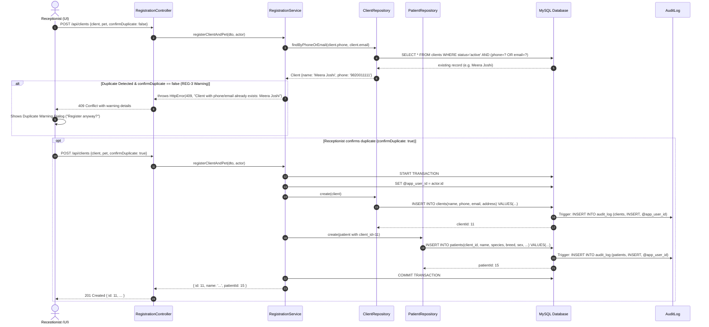
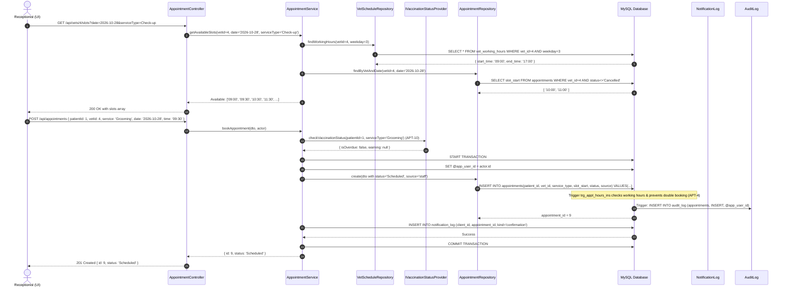
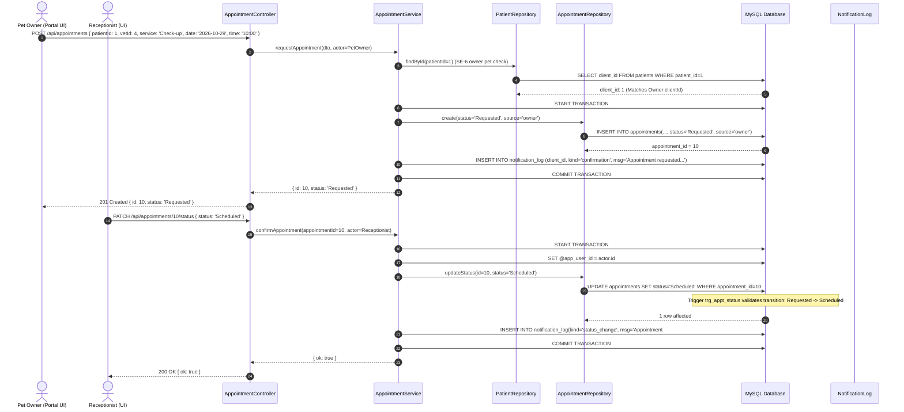
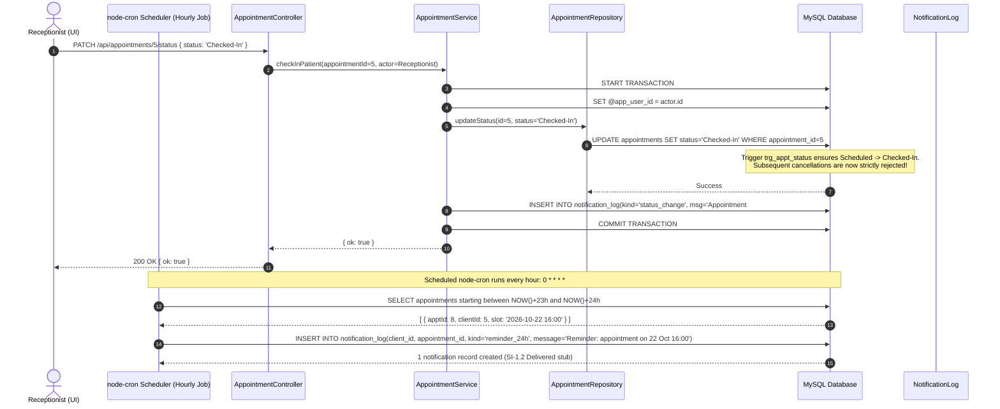

# Sequence Diagrams - Veterinary Clinic Management System (VCMS)
## Core Use Cases across Module 1 and Module 2
### Showing UI -> Controller -> Service -> Repository -> Database and Side Effects

---

## 2.a. Register New Client + Pet (with Duplicate Warning Check: REG-1, REG-2, REG-3)



---

## 2.b. Merge Duplicate Clients (REG-4)

```mermaid
sequenceDiagram
    autonumber
    actor User as Receptionist / Admin (UI)
    participant RC as RegistrationController
    participant RS as RegistrationService
    participant CR as ClientRepository
    participant DB as MySQL Database
    participant AL as AuditLog

    User->>RC: POST /api/clients/merge { keepId: 1, dropId: 6 }
    RC->>RS: mergeDuplicateClients(keepId=1, dropId=6, actor)
    
    alt Validation: keepId == dropId
        RS-->>RC: throws HttpError(400, "Choose two different clients")
        RC-->>User: 400 Bad Request
    else Valid Merge
        RS->>DB: START TRANSACTION
        RS->>DB: SET @app_user_id = actor.id
        RS->>CR: mergeClients(keepId=1, dropId=6)
        CR->>DB: CALL merge_clients(1, 6)
        Note over DB: UPDATE patients SET client_id=1 WHERE client_id=6;<br/>UPDATE clients SET status='merged', merged_into=1 WHERE client_id=6;
        DB->>AL: Trigger: INSERT INTO audit_log (clients, UPDATE status='merged', @app_user_id)
        DB-->>CR: Success
        RS->>DB: COMMIT TRANSACTION
        RS-->>RC: { ok: true }
        RC-->>User: 200 OK { ok: true }
    end
```

---

## 2.c. Book Appointment as Receptionist (APT-1, APT-3, APT-4, APT-10, BR-3)



---

## 2.d. Pet Owner Requests Appointment -> Receptionist Confirms (APT-2)



---

## 2.e. Reschedule and Cancel Appointment (APT-5, APT-6)

```mermaid
sequenceDiagram
    autonumber
    actor User as Receptionist / Pet Owner (UI)
    participant AC as AppointmentController
    participant AS as AppointmentService
    participant AR as AppointmentRepository
    participant DB as MySQL Database
    participant NL as NotificationLog
    participant AL as AuditLog

    %% Reschedule Scenario (APT-5)
    rect rgb(240, 248, 255)
        note over User, DB: Reschedule Appointment (Only allowed for 'Scheduled' / 'Confirmed')
        User->>AC: PATCH /api/appointments/4/reschedule { date: '2026-10-30', time: '14:00' }
        AC->>AS: rescheduleAppointment(id=4, date, time, actor)
        AS->>AR: findById(id=4)
        AR->>DB: SELECT * FROM appointments WHERE appointment_id=4
        DB-->>AR: Appointment { status: 'Scheduled' }
        AS->>DB: START TRANSACTION
        AS->>DB: SET @app_user_id = actor.id
        AS->>AR: updateSlot(id=4, slotStart='2026-10-30 14:00:00')
        AR->>DB: UPDATE appointments SET slot_start=? WHERE appointment_id=4 AND status='Scheduled'
        Note over DB: Trigger trg_appt_hours_upd validates new slot and prevents overlap
        DB->>AL: Trigger: INSERT INTO audit_log
        DB-->>AR: Success
        AS->>DB: INSERT INTO notification_log(kind='status_change', msg='Appointment moved...')
        AS->>DB: COMMIT TRANSACTION
        AS-->>AC: { ok: true }
        AC-->>User: 200 OK { ok: true }
    end

    %% Cancel Scenario (APT-6)
    rect rgb(255, 245, 245)
        note over User, DB: Cancel Appointment (Requires Reason; only before Checked-In)
        User->>AC: PATCH /api/appointments/4/status { status: 'Cancelled', reason: 'Owner emergency travel' }
        AC->>AS: cancelAppointment(id=4, reason='...', actor)
        AS->>AR: findById(id=4)
        AR->>DB: SELECT * FROM appointments WHERE appointment_id=4
        DB-->>AR: Appointment { status: 'Scheduled' }
        AS->>DB: START TRANSACTION
        AS->>DB: SET @app_user_id = actor.id
        AS->>AR: updateStatus(id=4, status='Cancelled', reason='...')
        AR->>DB: UPDATE appointments SET status='Cancelled', cancellation_reason=? WHERE appointment_id=4
        Note over DB: Trigger trg_appt_status validates transition: Scheduled -> Cancelled
        DB->>AL: Trigger: INSERT INTO audit_log
        DB-->>AR: Success
        AS->>DB: INSERT INTO notification_log(kind='status_change', msg='Appointment #4 is now Cancelled')
        AS->>DB: COMMIT TRANSACTION
        AS-->>AC: { ok: true }
        AC-->>User: 200 OK { ok: true }
    end
```

---

## 2.f. Check-In (APT-7) and Confirmation / 24-Hour Reminder (APT-9, CI-1, CI-2)


